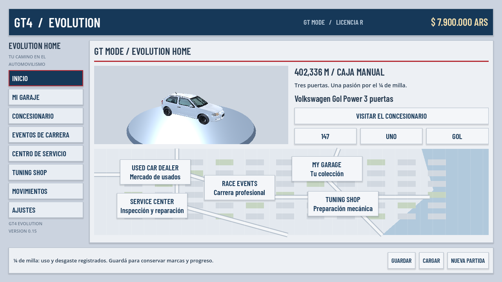
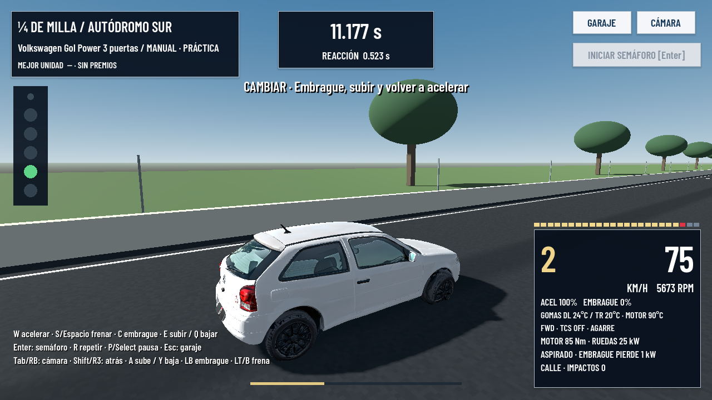
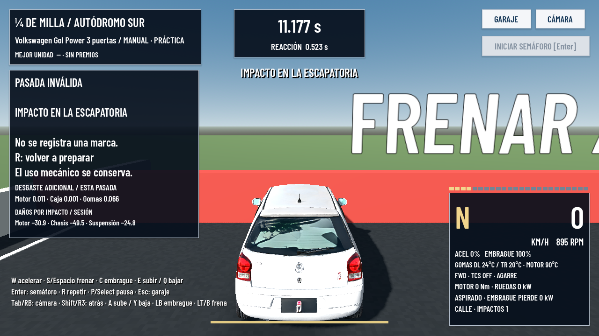
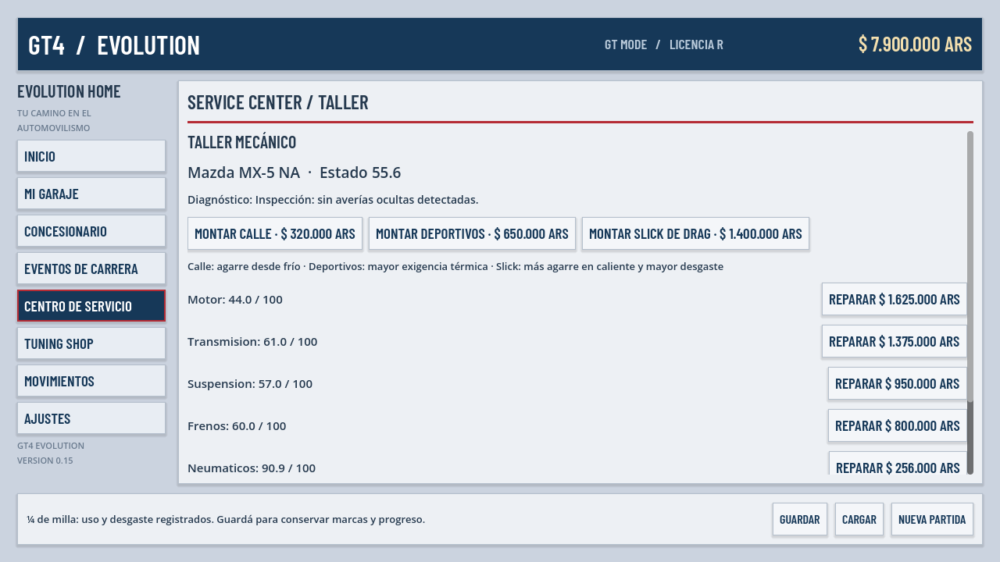
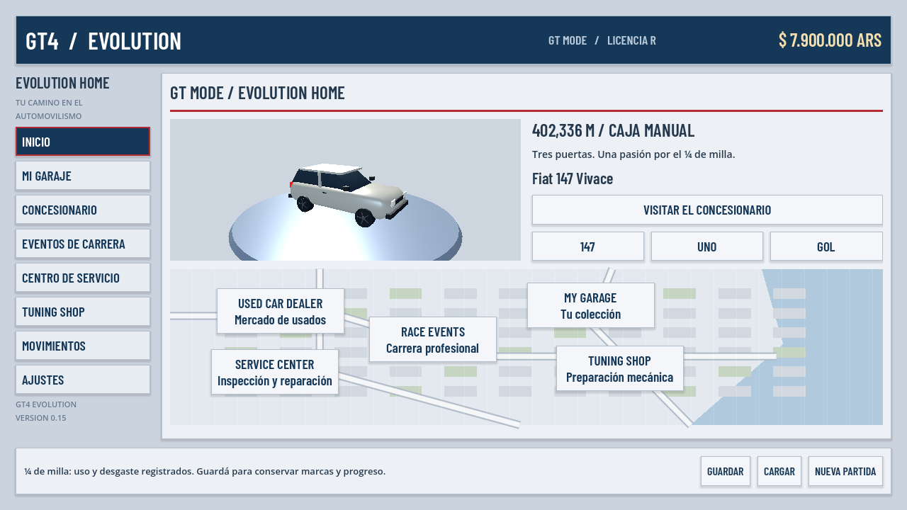
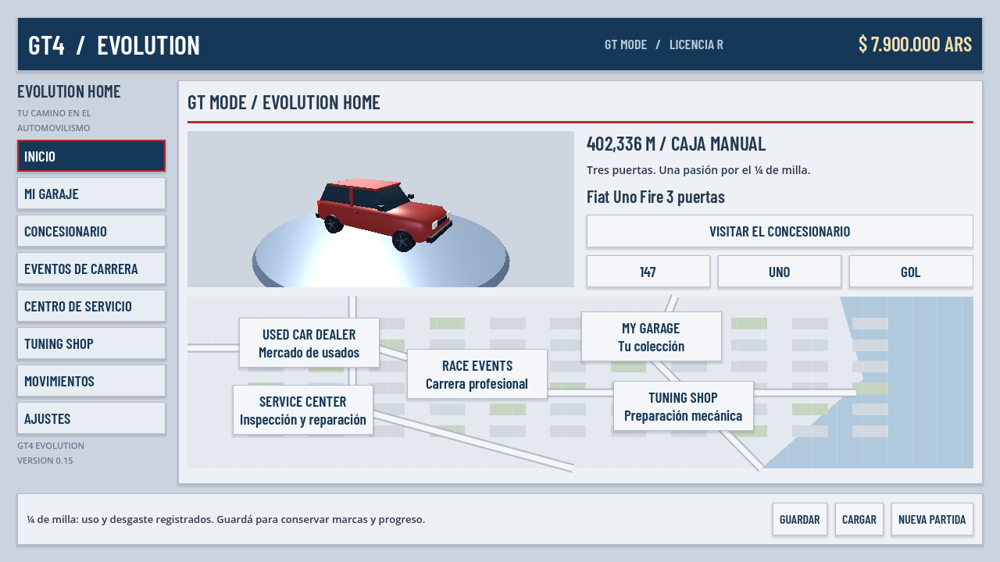
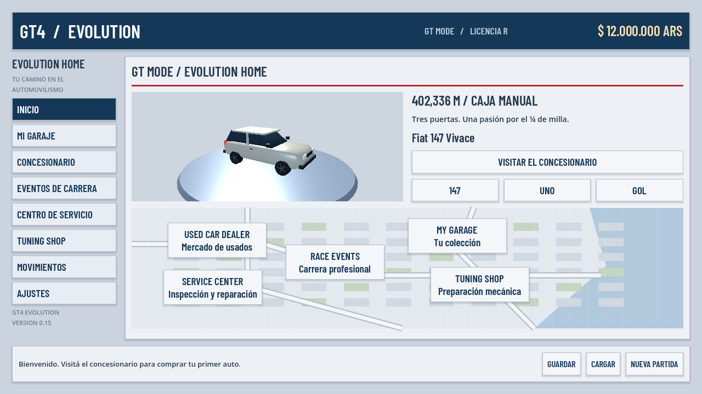
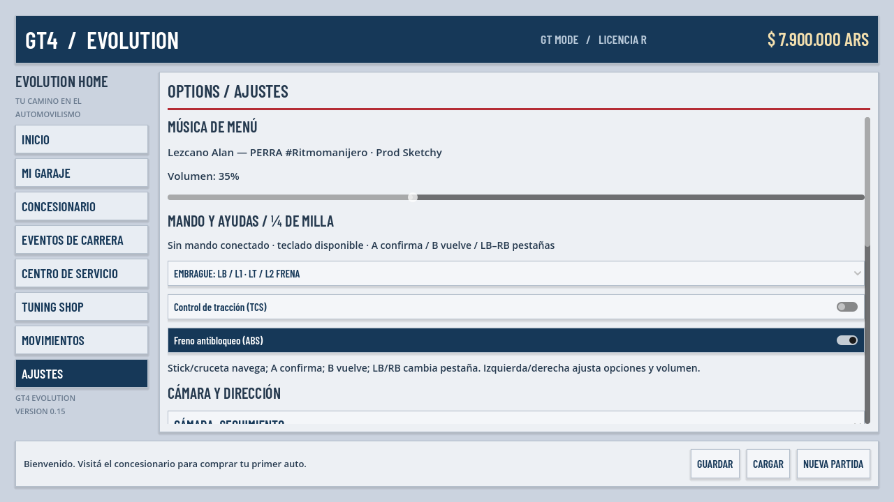
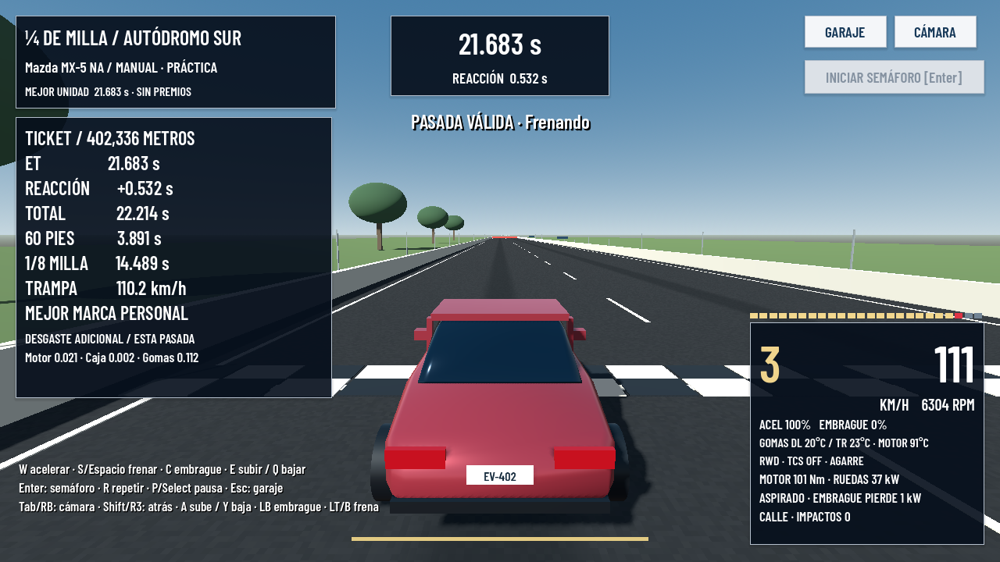
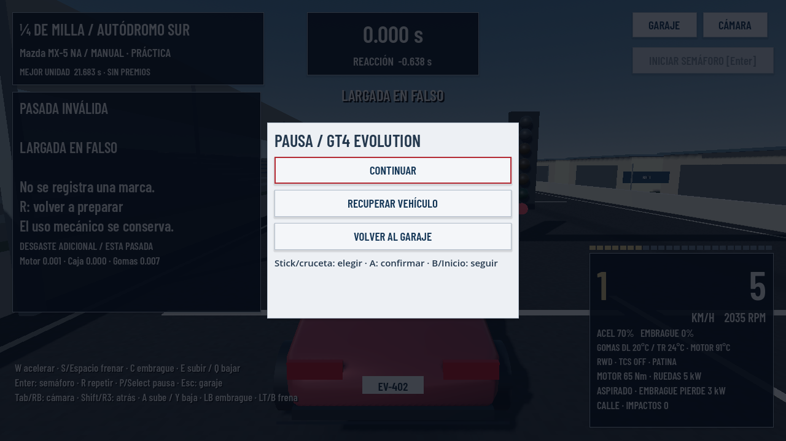

# GT4 Evolution 0.15 · Descargas

- [Descargar juego para Windows](https://github.com/arellanoalexisgabriel25-spec/gt4-evolution/raw/refs/heads/downloads/v0.15/GT4-Evolution-0.15-Windows.zip)
- [Descargar proyecto para Godot](https://github.com/arellanoalexisgabriel25-spec/gt4-evolution/raw/refs/heads/downloads/v0.15/GT4-Evolution-0.15-Proyecto.zip)

Extraé TODO el ZIP Windows y abrí **JUGAR.cmd**. El motor está incluido.
Los autos insignia son 147 Vivace, Uno Fire 3 puertas y Gol Power 3 puertas.
El Gol usa el modelo texturizado aportado. Los otros dos modelos adjuntos aún
requieren acceso; sus carrocerías siguen provisionales, con configuraciones propias.
En Inicio podés elegir 147 / UNO / GOL; en el garaje, VER MODELO cambia la vista.
El taller ofrece calle, deportivos o slick. Los impactos en el ¼ de milla dejan
daño mecánico persistente y reducen rendimiento. Recuperar no repara el auto.

Comprá un auto y abrí **GARAJE → ¼ DE MILLA / MANUAL**. Mantené C, tocá E
para primera, iniciá el árbol con Enter y esperá el verde. Regulá W para las RPM,
soltá C para largar y usá C+E en cada cambio. Q baja. R prepara otra pasada.
La práctica no cobra ni da premios en pesos; sí registra uso y desgaste.
Volvé al garaje y presioná GUARDAR para conservar marcas y progreso.
AJUSTES permite reasignar las teclas. El circuito del club sigue disponible.
Los importes están en pesos argentinos. Se incluye la música de menú aportada
por el usuario y autorizada para redistribución; volumen en AJUSTES.
Mando: stick/cruceta navega, A confirma, B vuelve, LB/RB cambia pestaña.
Select/Back abre la pausa en pista; embrague analógico LT/L2 opcional.

El paquete incluye LEEME.txt con controles y limitaciones, y DIAGNOSTICO.cmd
para registrar fallos de arranque. Windows y los mandos físicos requieren
prueba en esos equipos; la validación automatizada se realiza en Linux.
Las licencias se incluyen. No se distribuyen recursos comerciales de GT4.

Código: [8e3da1a](https://github.com/arellanoalexisgabriel25-spec/gt4-evolution/commit/8e3da1a039558e5350eeb9ca551a290903f095c5).
Esta rama contiene únicamente distribución y no se integra en main.
Los archivos .sha256 permiten verificar los ZIP.

## Presentación 0.15

Capturas reales del juego en Linux con OpenGL por software. No son renders conceptuales.

Tab / RB cambia entre seguimiento, cercana, capó y paragolpes; Shift / Y permite mirar atrás.
AJUSTES conserva la cámara inicial y permite suavizar la dirección del teclado.

### Gol Power / Modelo aportado

### Gol en una pasada manual real

### Impacto real / Daños mecánicos

### Taller / Compuestos de neumáticos

### 147 Vivace / Carrocería provisional

### Uno Fire / Carrocería provisional

### Inicio y autos insignia

### Música, mando y ayudas

### Ticket de llegada real

### Pausa con mando

