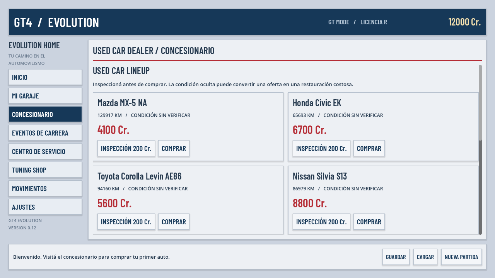
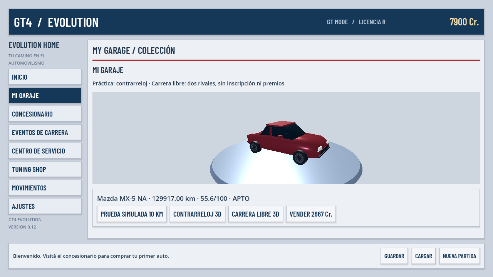
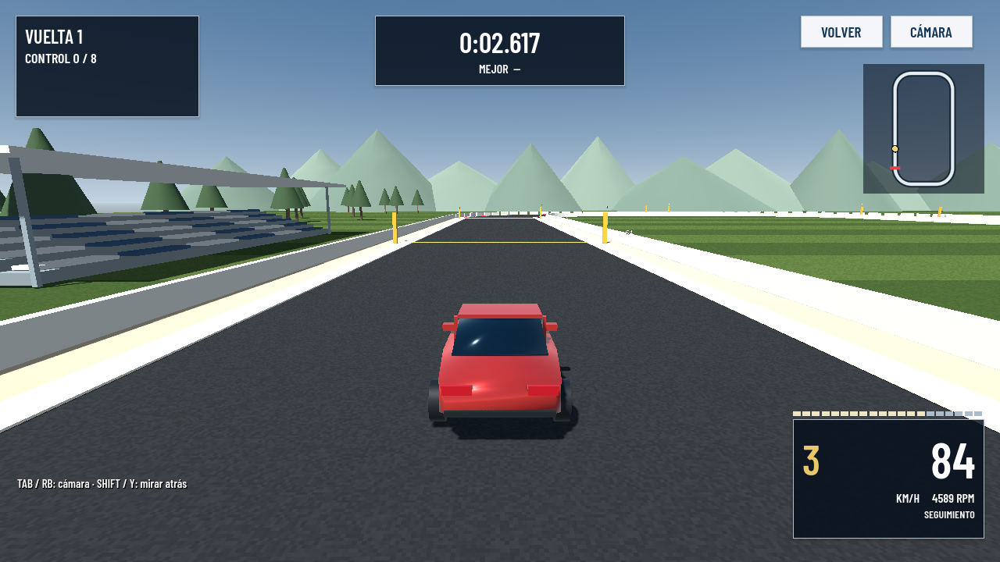
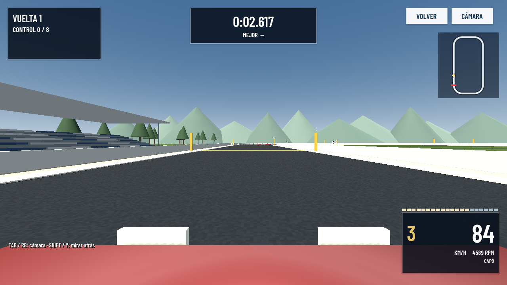
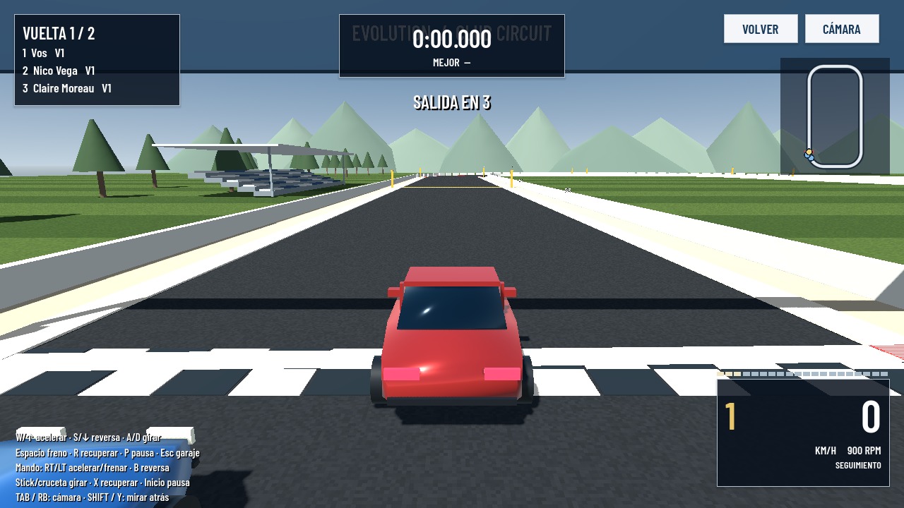

# GT4 Evolution 0.12 · Descargas

- [Descargar juego para Windows](https://github.com/arellanoalexisgabriel25-spec/gt4-evolution/raw/refs/heads/downloads/v0.12/GT4-Evolution-0.12-Windows.zip)
- [Descargar proyecto para Godot](https://github.com/arellanoalexisgabriel25-spec/gt4-evolution/raw/refs/heads/downloads/v0.12/GT4-Evolution-0.12-Proyecto.zip)

Extraé TODO el ZIP Windows y abrí **JUGAR.cmd**. El motor está incluido.
Comprá un auto; en GARAJE hay práctica y carrera libre. En MODO CARRERA,
Debutantes se corre en pista con inscripción y premios. Volvé al garaje y
presioná GUARDAR para conservar el progreso. AJUSTES permite cambiar controles.

El paquete incluye LEEME.txt con controles y limitaciones, y DIAGNOSTICO.cmd
para registrar fallos de arranque. Windows y los mandos físicos requieren
prueba en esos equipos; la validación automatizada se realiza en Linux.
Las licencias se incluyen. No se distribuyen recursos comerciales de GT4.

Código: [4f04ce4](https://github.com/arellanoalexisgabriel25-spec/gt4-evolution/commit/4f04ce4aa50d46a80c0eaca59b311b6b0bd269bc).
Esta rama contiene únicamente distribución y no se integra en main.
Los archivos .sha256 permiten verificar los ZIP.

## Presentación 0.12

Capturas reales del juego en Linux con OpenGL por software. No son renders conceptuales.

Tab / RB cambia entre seguimiento, cercana, capó y paragolpes; Shift / Y permite mirar atrás.
AJUSTES conserva la cámara inicial y permite suavizar la dirección del teclado.

### Inicio y mapa de servicios

### Concesionario

### Garaje

### Cámara de seguimiento y HUD

### Vista de capó

### Parrilla de carrera

