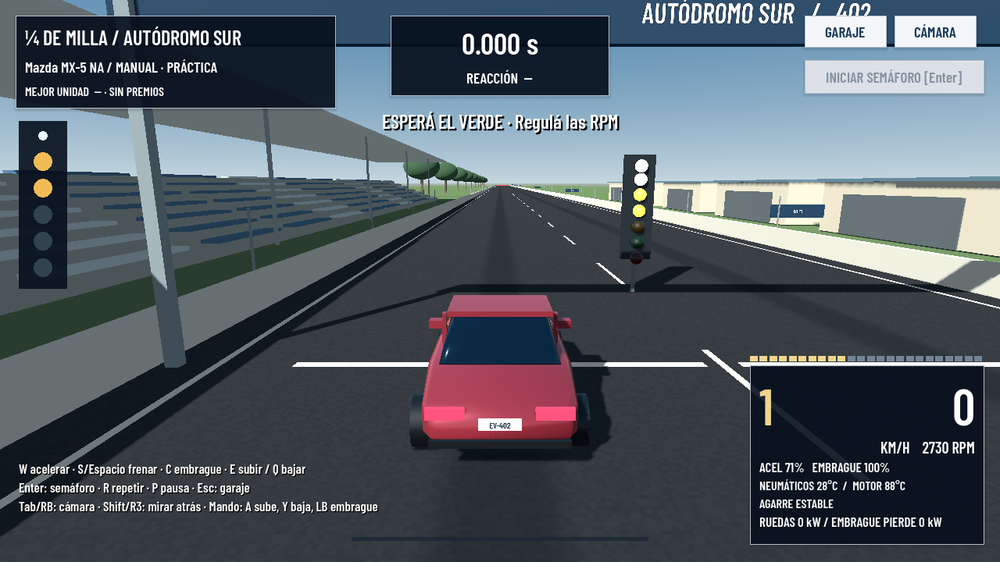
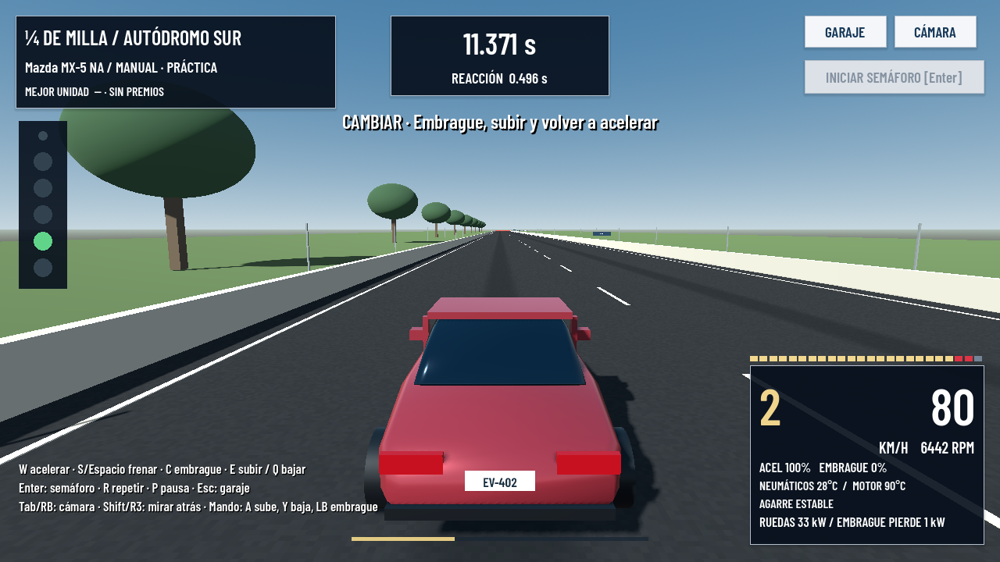

# GT4 Evolution 0.13 · Descargas

- [Descargar juego para Windows](https://github.com/arellanoalexisgabriel25-spec/gt4-evolution/raw/refs/heads/downloads/v0.13/GT4-Evolution-0.13-Windows.zip)
- [Descargar proyecto para Godot](https://github.com/arellanoalexisgabriel25-spec/gt4-evolution/raw/refs/heads/downloads/v0.13/GT4-Evolution-0.13-Proyecto.zip)

Extraé TODO el ZIP Windows y abrí **JUGAR.cmd**. El motor está incluido.
Comprá un auto y abrí **GARAJE → ¼ DE MILLA / MANUAL**. Mantené C, tocá E
para primera, iniciá el árbol con Enter y esperá el verde. Regulá W para las RPM,
soltá C para largar y usá C+E en cada cambio. Q baja. R prepara otra pasada.
La práctica no cobra ni da premios en créditos; sí registra uso y desgaste.
Volvé al garaje y presioná GUARDAR para conservar marcas y progreso.
AJUSTES permite reasignar las teclas. El circuito del club sigue disponible.

El paquete incluye LEEME.txt con controles y limitaciones, y DIAGNOSTICO.cmd
para registrar fallos de arranque. Windows y los mandos físicos requieren
prueba en esos equipos; la validación automatizada se realiza en Linux.
Las licencias se incluyen. No se distribuyen recursos comerciales de GT4.

Código: [67f40b5](https://github.com/arellanoalexisgabriel25-spec/gt4-evolution/commit/67f40b59d62459481bbc97f9a8245eb96891460a).
Esta rama contiene únicamente distribución y no se integra en main.
Los archivos .sha256 permiten verificar los ZIP.

## Presentación 0.13

Capturas reales del juego en Linux con OpenGL por software. No son renders conceptuales.

Tab / RB cambia entre seguimiento, cercana, capó y paragolpes; Shift / Y permite mirar atrás.
AJUSTES conserva la cámara inicial y permite suavizar la dirección del teclado.

### Preparación / Autódromo Sur

### Semáforo

### Pasada con cambios manuales

### Carrocería y cámara cercana

### Ticket de una llegada real

### Largada anticipada invalidada

### Inicio y mapa de servicios

### Garaje

