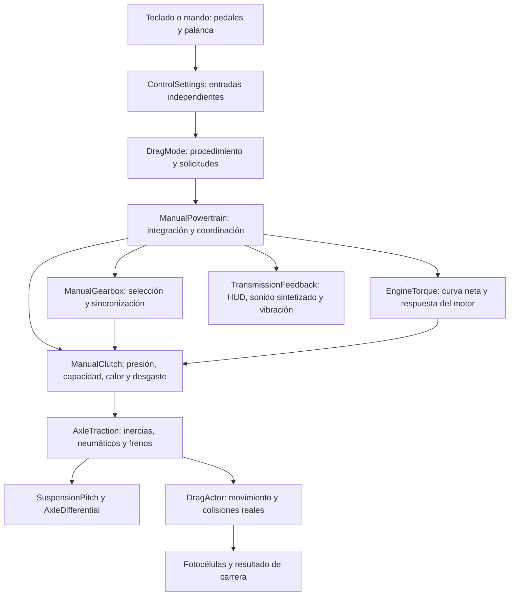

# Transmisión y dinámica longitudinal — 0.24

La transmisión manual usa estados separados para el cigüeñal, el eje de entrada de la caja y los dos ejes de ruedas. El acelerador, el embrague y el freno son entradas independientes: mantener el acelerador no impide solicitar una marcha. La entrega de par depende del acople físico posterior, de la sincronización y del estado mecánico.

Este incremento mejora el simulador existente. Es un modelo longitudinal reducido; no constituye una reproducción de la física interna de Gran Turismo 4 ni una validación instrumental de un automóvil de fábrica.

## Arquitectura



| Responsabilidad | Implementación |
| --- | --- |
| Configuración de cada unidad y vehículo | [`drag_vehicle_config.gd`](scripts/drag_vehicle_config.gd) |
| Pedales, teclas, mando y preferencias persistentes | [`control_settings.gd`](scripts/control_settings.gd) |
| Preparación, llamada a pista, largada y conexión con la escena | [`drag_mode.gd`](scripts/drag_mode.gd) |
| Selección, eje de entrada y tiempo de sincronización | [`manual_gearbox.gd`](scripts/manual_gearbox.gd) |
| Presión del embrague, temperatura y degradación térmica | [`manual_clutch.gd`](scripts/manual_clutch.gd) |
| Integración del cigüeñal, acople, relaciones, pérdidas y daño | [`manual_powertrain.gd`](scripts/manual_powertrain.gd) |
| Curva de par y respuesta de sobrealimentación | [`engine_torque.gd`](scripts/engine_torque.gd) |
| Inercias por eje, adherencia y frenado | [`axle_traction.gd`](scripts/axle_traction.gd) |
| Cabeceo de la carrocería | [`suspension_pitch.gd`](scripts/suspension_pitch.gd) |
| Límite de tracción con adherencia izquierda/derecha desigual | [`axle_differential.gd`](scripts/axle_differential.gd) |
| Eventos de acople/rechazo para presentación | [`transmission_feedback.gd`](scripts/transmission_feedback.gd) |

Los módulos de presentación observan resultados; no engranan marchas ni modifican el par. La persistencia conserva la salud del motor y la transmisión mediante las claves existentes del vehículo.

## Flujo completo de un cambio

1. El jugador mueve la palanca con `E` o `Q`. `DragMode` solicita el cambio mediante `request_shift(dirección, pedal_embrague)`. El acelerador puede permanecer presionado.
2. Se comprueban la dirección solicitada, los límites de la caja y el cambio que ya esté en curso. Se rechaza insertar reversa con el auto avanzando y una marcha de avance mientras retrocede. Salir de reversa hacia neutro sigue siendo posible.
3. En manual, el pedal debe superar `clutch_release_pedal`. Existe una ventana de entrada de 100 ms para tolerar el orden de entrega de los botones en un mismo gesto. Esa ventana no pisa el embrague ni levanta el acelerador por el jugador. Vencida sin embrague, se aplica el rechazo normal.
4. Como excepción deliberada, un cambio entre marchas de avance puede entrar sin embrague si la diferencia de régimen es menor de 120 rpm y el acelerador está por debajo del 8 %. Es una representación simplificada del cambio sin embrague con descarga y sincronización precisas; no es una asistencia automática.
5. La selección aceptada actualiza `gear`, que representa la posición elegida por la palanca. La caja entra en fase `shifting`. El régimen del motor no se asigna al nuevo régimen de rueda.
6. El sincronizador aproxima la velocidad del eje de entrada a la exigida por la nueva relación. La duración inicial se estima a partir de la diferencia de velocidad, la inercia y el par del sincronizador, con un mínimo nominal `shift_time`. Si las ruedas cambian de régimen durante la maniobra, la caja sigue ese objetivo móvil y puede extender la espera hasta `synchronizer_max_time`. Sólo termina el enganche dentro de `synchronizer_tolerance_rpm`, cuyo valor predeterminado es 60 rpm. Durante ese intervalo no hay transmisión de par a través de la marcha seleccionada.
7. Al soltar el pedal, la presión deseada se obtiene de la zona de mordida. La presión efectiva cambia con tiempos finitos de apertura y cierre. Soltar un botón produce una maniobra rápida, pero no un acople matemáticamente instantáneo.
8. Con la sincronización terminada y presión suficiente, se clasifica el acople por la diferencia de rpm. En cambios entre marchas de avance: menos de 180 rpm es perfecto, menos de 900 aceptable y el resto brusco. La clasificación alimenta el feedback; la pérdida y el daño surgen del deslizamiento y del régimen físico, no de un premio o castigo arbitrario de esa etiqueta.
9. El par vuelve progresivamente a las ruedas, limitado por el embrague, el estado de transmisión y las pérdidas. Si se soltó el embrague con el motor muy acelerado, parte del trabajo se convierte en calor. Si se eligió una reducción excesiva, las ruedas pueden forzar un sobrerégimen aunque la inyección esté cortada.

No se acepta otra solicitud durante la sincronización. El HUD informa que el cambio sigue en curso, en lugar de aparentar una tecla que no responde. Si vence el máximo sin alcanzar la tolerancia, se rechaza el enganche, la palanca queda en neutro, se registran el evento y el desgaste de transmisión, y hace falta una nueva solicitud. El vencimiento no proporciona un impulso artificial ni ajusta instantáneamente las rpm de los ejes.

## Datos y unidades

`DragVehicleConfig` es un `Resource` de Godot. Sus parámetros se exportan para permitir configuraciones de cinco o seis marchas sin reescribir la lógica. Las relaciones son magnitudes adimensionales; la marcha atrás recibe signo negativo en el cálculo.

| Grupo | Variables principales | Unidad / significado |
| --- | --- | --- |
| Relaciones | `gear_ratios`, `reverse_ratio`, `final_drive` | Relaciones de avance, reversa y grupo final |
| Sincronización | `shift_time`, `synchronizer_max_time` | s; mínimo y máximo del proceso reducido |
| Eje de entrada | `gearbox_input_inertia`, `synchronizer_torque` | kg·m² y N·m |
| Tolerancia de sincronización | `synchronizer_tolerance_rpm` | rpm de diferencia permitida para terminar el enganche |
| Motor | `peak_torque`, `torque_rpm`, `torque_curve` | N·m, rpm y factores de la curva neta |
| Dinámica del motor | `engine_inertia`, `idle_rpm`, `redline_rpm` | kg·m² y rpm |
| Embrague | `clutch_capacity` | N·m de capacidad nominal antes de condición/presión/temperatura |
| Recorrido del pedal | `clutch_bite_pedal`, `clutch_release_pedal` | 0…1; 0 es pedal suelto y 1 pisado a fondo |
| Actuación | `clutch_engage_time`, `clutch_disengage_time` | s para recorrer toda la presión efectiva |
| Calor | `clutch_heat_capacity`, `clutch_cooling_w_per_k` | J/K y W/K |
| Degradación | `clutch_fade_start_c`, `clutch_fade_end_c`, `clutch_wear_per_joule` | °C y puntos de condición por J |
| Sobrerégimen | `overrev_wear_per_second` | Coeficiente de daño por exceso relativo de rpm |
| Pérdidas | `drivetrain_efficiency` | Eficiencia de transmisión entre 0 y 1 |
| Rodadura | `wheel_radius`, `wheel_inertia` | m y kg·m² por eje |
| Masa | `curb_mass`, `driver_mass` | kg; `mass` suma ambas |
| Suspensión | `suspension_pitch_stiffness_nm_rad` | N·m/rad |
| Amortiguación | `suspension_pitch_damping_nms_rad` | N·m·s/rad |
| Inercia de cabeceo | `suspension_pitch_inertia_kg_m2` | kg·m² |
| Diferencial | `differential_type`, `differential_bias_ratio`, `differential_preload_nm` | `open`, `limited_slip` o `locked`; sesgo y precarga |

Los valores predeterminados de sincronizadores, embrague, suspensión y diferencial son estimaciones de desarrollo. `from_vehicle()` escala rigidez, amortiguación e inercia de cabeceo por `curb_mass / 1000`; es una regla provisional de tamaño, no una identificación experimental de la suspensión. El perfil de cada modelo puede sobrescribir individualmente los parámetros de caja, embrague, suspensión y diferencial con claves del mismo nombre. Los campos nuevos se añaden a la lista de estimaciones de la ficha. Exportar un valor no lo convierte en dato de fabricante. La procedencia y los campos estimados de las fichas se distinguen en [`CALIBRATION-0.24.md`](CALIBRATION-0.24.md).

## Régimen, par y conservación de energía

Para una marcha de avance:

```text
R = relación_marcha × relación_final
ω_objetivo = ω_rueda_motriz × R
RPM_objetivo = ω_objetivo × 60 / (2π)
```

Para reversa, `R = −reverse_ratio × final_drive`; para neutro, `R = 0`. El objetivo usa velocidad angular de las ruedas motrices, no solamente velocidad del vehículo: durante un burnout ambas difieren. `target_rpm()` es una consulta; no teletransporta el cigüeñal a ese valor.

El motor integra su velocidad con inercia:

```text
ω_motor(t + dt) = max(0, ω_motor + (T_motor_neto − T_embrague) × dt / I_motor)
```

`T_motor_neto` parte de la curva de par neto al cigüeñal y el acelerador. Incluye estado, temperatura, corte y sobrealimentación donde corresponde. Las pérdidas de bombeo actúan al levantar el pedal y en corte; no se vuelve a descontar toda la fricción interna a plena carga sobre una curva que ya es neta.

El embrague compara `ω_motor` con `ω_rueda × R`. Su par se limita por capacidad nominal, condición mecánica, presión efectiva y degradación térmica. En manual, la condición usa `(salud_transmisión / 100)^0,7`, una curva estimada que llega a capacidad nula cuando el embrague queda agotado; la CVT mantiene su modelo propio. Un límite de impulso evita atravesar artificialmente el punto de sincronismo dentro de un subpaso y crear energía por sobrecorrección.

En propulsión, `T_rueda = T_embrague × R × η`. Cuando las ruedas arrastran al motor, el cálculo invierte el factor de eficiencia según el sentido de la potencia: las ruedas deben perder más potencia de la que recibe el cigüeñal. Esto también importa en reversa y al rodar hacia atrás con una marcha de avance.

```text
P_deslizamiento = |T_embrague × (ω_motor − ω_rueda × R)|
Q = P_deslizamiento × dt
```

Ese trabajo calienta el paquete de fricción. El enfriamiento usa una respuesta exponencial con capacidad térmica y pérdidas al ambiente, incrementadas con velocidad. La capacidad transmisible disminuye progresivamente entre los umbrales térmicos y el desgaste por joule aumenta con la temperatura. Se contabiliza una sola vez en `wear.transmision`.

`step()` limita el intervalo integrado a 0,1 s y subdivide a unos 480 Hz. La escena debe llamarlo a cada tick físico: pasar un intervalo muy grande no simula todo ese tiempo perdido. La integración evita depender del número de cuadros dibujados, pero sigue siendo una aproximación numérica.

## Embrague, largada y reducción

En el teclado predeterminado, `C` pisa el embrague, `W` acelera y `S` o Espacio frenan en el modo de picadas. Los tres pedales son independientes. En este modo `S` no selecciona reversa.

Para primera, partir de neutro, mantener `C` y pulsar `E`. Para marcha atrás, detenerse, volver a neutro y usar `C + Q`; soltar el embrague con control y acelerar. `E` desde reversa vuelve a neutro. `R` es recuperar vehículo; no es seleccionar la marcha atrás. Las teclas se pueden reasignar desde las opciones.

En mando, el gatillo derecho acelera, el hombro izquierdo permite pisar embrague y los botones de cambio solicitan subir o bajar. La configuración permite usar el gatillo izquierdo como embrague analógico. En esa modalidad, el freno permanece disponible con el botón B; revisar la guía visible de controles si se cambia la asignación.

La preparación y el árbol de largada pertenecen al procedimiento deportivo. El manual total debe conservar el embrague pisado mientras espera el verde; no existe liberación automática en ese modo. El freno de mano sigue actuando hasta que el jugador lo suelta. Las indicaciones explican qué pedal está reteniendo el auto.

Un régimen de largada alto con liberación rápida puede generar patinamiento de neumáticos, deslizamiento del embrague o ambos, según relaciones, condición y adherencia. Un régimen bajo con acople brusco puede calar el motor. Mantener un acople parcial bajo carga acumula calor y desgaste: no hay un botón de burnout que añada temperatura sin trabajo mecánico.

Para punta-tacón, frenar, pisar embrague, solicitar una reducción y dar un golpe de acelerador antes de volver a acoplar. El modelo permite acelerar y frenar simultáneamente. La destreza consiste en aproximar el régimen real del motor al requerido por la nueva marcha; sostener un acelerador alto sin control puede empeorar la diferencia.

## Asistencias explícitas

`ControlSettings` guarda `shift_mode` y `auto_rev_match` en el archivo existente `controls_v1.json`. Una partida de controles anterior adopta manual y rev-matching desactivado si esos campos no existían; se preservan las teclas anteriores.

| Modo | Comportamiento |
| --- | --- |
| `manual` — predeterminado | El jugador opera embrague y palanca. No hay apertura de embrague ni levantada forzada de acelerador. |
| `auto_clutch` | El jugador pide cada marcha; un actuador abre y cierra el embrague con tiempo finito. No corta el acelerador por ese hecho. |
| `semi_auto` | El jugador pide las marchas; usa actuador de embrague y descarga del acelerador durante la sincronización. No decide automáticamente cuándo subir o bajar. |
| `auto_rev_match` — opción independiente | Con embrague abierto y marcha de avance pendiente de acoplar, añade acelerador si faltan rpm. No asigna rpm y no protege de una reducción mecánicamente excesiva. |

Las ayudas de transmisión no cambian las relaciones, la adherencia ni los límites del motor. En modos con embrague asistido, el procedimiento mantiene el acople abierto durante la espera del árbol y termina esa retención al verde. El jugador puede pisar más embrague que la asistencia: el comando manual no se anula por un cierre automático.

## Daños y feedback

- Un intento sin embrague y sin coincidencia precisa se rechaza, suma un cambio fallido y desgaste de transmisión.
- El mal acople pierde energía en calor. El exceso de temperatura reduce capacidad y acelera desgaste, haciendo que el problema afecte también a los intentos siguientes.
- El corte de inyección retira par del motor al alcanzar el régimen límite, con histéresis para evitar conmutaciones numéricas rápidas. No impide que las ruedas lo sobreaceleren mediante una reducción.
- El daño por sobrerégimen aumenta con el cuadrado del exceso relativo. Un exceso severo sostenido puede producir falla mecánica y dejar la salud del motor por debajo del umbral de arranque. Recuperar la posición del vehículo no restaura esa salud; corresponde reparar en el taller.
- Un evento identifica cambio perfecto, aceptable, brusco o rechazado. HUD, sonido de síntesis y vibración de mando consumen ese evento sin intervenir en la física. No se incluyen grabaciones verificadas de una caja específica.

La temperatura y el daño no se borran al recuperar el vehículo en el intento. El daño consolidado sigue usando la economía y el sistema de reparación existentes. La temperatura del paquete de fricción es un estado de la sesión de conducción, no una nueva variable de guardado permanente.

## Suspensión y diferencial

El cabeceo responde a un momento longitudinal con muelle, amortiguador e inercia. Su integración lineal es analítica para el momento mantenido en cada subpaso. El desgaste de suspensión reduce amortiguación; la respuesta alimenta la transferencia de carga y la inclinación visual. La pendiente aporta además la transferencia estática correspondiente.

El circuito muestrea soporte y adherencia en cuatro contactos. El diferencial utiliza esos contactos para limitar la capacidad de tracción del eje motriz:

```text
abierto: 2 × capacidad_del_contacto_más_débil
autoblocante: débil + min(fuerte, débil × sesgo + precarga/radio)
bloqueado: débil + fuerte
```

Es un límite de capacidad de tracción: no multiplica el par del motor ni crea potencia. El frenado conserva el límite de los contactos independientemente de ese sesgo de propulsión.

El modelo todavía tiene una velocidad angular e inercia por eje, no cuatro ruedas independientes. No resuelve geometría de brazos, convergencia dinámica, baches con recorrido individual, torsión de semiejes ni calor de bloqueo del diferencial. Tampoco reproduce por separado un diferencial central activo. Esos límites condicionan cualquier interpretación de «hiperrealismo».

## Integración y extensión

El código de juego debe construir la configuración desde la unidad del garaje y mantener la misma instancia física durante la conducción. Ejemplo de uso de la API implementada:

```gdscript
const Powertrain = preload("res://scripts/manual_powertrain.gd")
const VehicleConfig = preload("res://scripts/drag_vehicle_config.gd")

var powertrain = Powertrain.new()

func prepare(vehicle: Dictionary) -> void:
    powertrain.config = VehicleConfig.from_vehicle(vehicle, true)
    powertrain.shift_mode = "manual"
    powertrain.auto_rev_match = false
    powertrain.reset(false)

func sample_physics(delta: float, pedals: Dictionary,
        surface: Dictionary, up_pressed: bool, down_pressed: bool) -> void:
    if up_pressed:
        powertrain.request_shift(1, float(pedals.clutch))
    elif down_pressed:
        powertrain.request_shift(-1, float(pedals.clutch))
    powertrain.step(delta, float(pedals.throttle), float(pedals.clutch),
        float(pedals.brake), true, surface,
        float(pedals.get("handbrake", 0.0)))
```

El ejemplo es para conectar otro actor a la misma API; la escena de picadas ya realiza esa conexión. No agregar un segundo cálculo de aceleración, otra curva de par o una segunda fuente de daño sobre ese mismo actor. La colisión y las fotocélulas deben seguir utilizando la posición recorrida en la escena, no una distancia teórica acumulada en el banco longitudinal.

Para una caja de seis marchas, definir seis elementos en `gear_ratios` y verificar los límites por régimen y velocidad con esa ficha. Para otra tecnología de sincronizador, extender `ManualGearbox` conservando el contrato de selección y de fase; la implementación actual es un sincronizador equivalente, no un modelo de conos y dientes individuales. El trabajo de sincronización se registra como diagnóstico relativo; todavía no se realimenta un modelo completo de inercia y reacción de todos los engranajes.

La CVT mantiene su módulo de variador y convertidor. Su selector tiene posiciones R/N/D: estando detenido, `Q` desde N selecciona R y `E` desde N selecciona D. La reversa utiliza una relación fija negativa, no recorre el variador de avance; conserva el convertidor para el acople a baja velocidad. No debe recibir la lógica de cambios numerados ni el embrague manual sólo para imitar la apariencia de una caja convencional.

## Verificación disponible

Las pruebas relevantes están en `tests/test_manual_realism.gd`, `tests/test_manual_input_settings.gd`, `tests/test_transmission_feedback.gd`, `tests/test_suspension_differential.gd`, las pruebas de integración de picadas y el banco longitudinal de la flota. El informe de entrega debe indicar cuáles se ejecutaron sobre el commit final y sus resultados; esta guía describe el diseño y no sustituye esa evidencia.

Las pruebas sintéticas de teclas comprueban el recorrido de entrada de Godot. No verifican el límite de pulsaciones simultáneas de cada teclado físico ni el force feedback real de todos los mandos. Las curvas y coeficientes estimados todavía requieren mediciones y contraste de telemetría por versión de vehículo.
